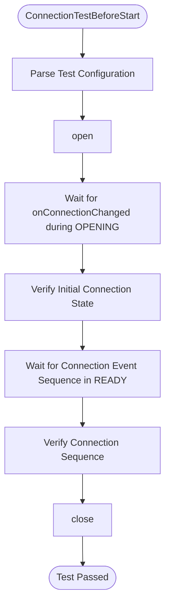
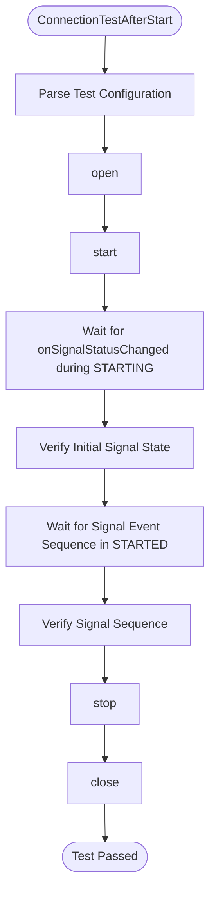
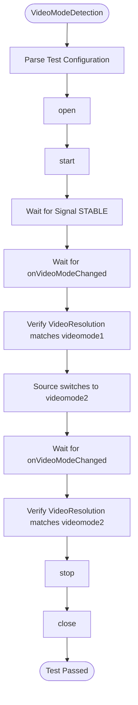
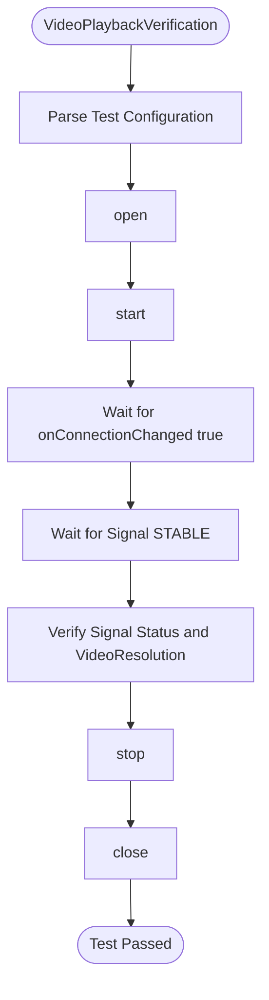
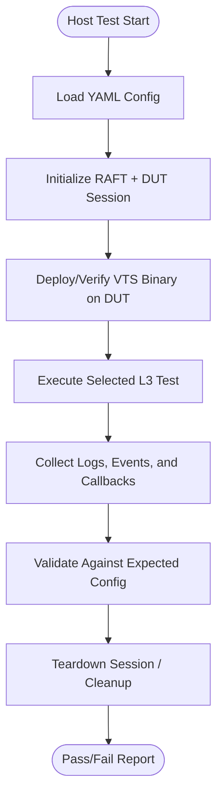

# Composite Input L3 Low Level Test Specification

## Table of Contents
- [Overview](#overview)
- [Acronyms, Terms and Abbreviations](#acronyms-terms-and-abbreviations)
- [References](#references)
- [Level 3 Test Specification](#level-3-test-specification)
    - [DUT Side Implementation](#dut-side-implementation)
    - [HOST Side Implementation](#host-side-implementation)

## Overview

This document defines the Level 3 (L3) Low-Level Test Specification for validating the Composite Input functionality in a device under test (DUT).
The objective of L3 testing is to validate low-level, event-driven state transitions, connection/signal callbacks, video mode detection, and property application through automated test execution using VTS and RAFT frameworks.

The goal is to ensure that:
- Composite input connection and signal states are reported correctly.
- Connection and signal callbacks are triggered as expected during state transitions.
- Video mode changes are detected and reported accurately.
- Property changes are applied and reflected through callbacks.

### Acronyms, Terms and Abbreviations

- `HAL`    - Hardware Abstraction Layer
- `VTS`    - Vendor Test Suite
- `L1`     - Level 1 Testing
- `L2`     - Level 2 Testing
- `L3`     - Level 3 Testing
- `DUT`    - Device Under Test
- `RAFT`   - Rapid Automation Framework for Testing
- `YAML`   - YAML Ain't Markup Language
- `AIDL`   - Android Interface Definition Language
- `HPD`    - Hot Plug Detect

### References

- High Level Test Specification - [compositeinput_High-Level_TestSpecification.md](compositeinput_High-Level_TestSpecification.md)
- [Composite Input AIDL interface](https://github.com/rdkcentral/rdk-halif-aidl/tree/main/compositeinput/)

## Level 3 Test Specification

### DUT Side Implementation

The VTS binary running on the DUT provides key L3 capabilities:
- ConnectionTestBeforeStart: Validate that `onConnectionChanged` fires during the OPENING phase and on HPD events in READY state.
- ConnectionTestAfterStart: Validate that `onSignalStatusChanged` fires during the STARTING phase and on signal events in STARTED state.
- VideoModeDetection: Validate that `onVideoModeChanged` fires with the correct `VideoResolution` after signal becomes STABLE.
- PropertyApplicationVerification: Validate that property set/get operations trigger `onPropertyChanged` callbacks with an active source.
- VideoPlaybackVerification: Validate end-to-end video playback readiness (signal STABLE, valid `VideoResolution`).

#### ConnectionTestBeforeStart

##### Objective

To verify that the DUT:
- Fires `onConnectionChanged` at least once during the OPENING transition (before READY) to report the initial connection state.
- Delivers subsequent connection events (HPD plug/unplug, power ON/OFF) in the expected sequence after READY.

##### Flow



##### Configuration File (YAML)

```yaml
compositeinput:
  L3:
    ConnectionTestBeforeStart:
      ports:
      - id: 0
        connection_state: true
        connection_sequence: [false, true, false, true]
        expect_signal_after_connect: false
        max_wait_time_ms: 10000
```

#### ConnectionTestAfterStart

##### Objective

To verify that the DUT:
- Fires `onSignalStatusChanged` at least once during the STARTING transition (before STARTED) to report the initial signal state.
- Delivers subsequent connection and signal events in the expected sequence after STARTED.

##### Flow



##### Configuration File (YAML)

```yaml
compositeinput:
  L3:
    ConnectionTestAfterStart:
      ports:
      - id: 0
        connection_state: true
        connection_sequence: [false, true]
        expect_signal_after_connect: true
        max_wait_time_ms: 10000
```

#### VideoModeDetection

##### Objective

To verify that the DUT:
- Fires `onVideoModeChanged` with the expected `VideoResolution` (resolution, format, frame rate) once the signal becomes STABLE.
- Reports updated resolution when the source switches video mode.
- Matches the reported mode to `getStatus().videoResolution`.

##### Flow



##### Configuration File (YAML)

```yaml
compositeinput:
  L3:
    VideoModeDetection:
      ports:
      - id: 0
        videomode1: {width: 1920, height: 1080, interlaced: false, framerate: 60}
        videomode2: {width: 3840, height: 2160, interlaced: false, framerate: 30}
        max_wait_time_ms: 10000
```

#### VideoPlaybackVerification

##### Objective

To verify that the DUT:
- Reports signal STABLE and a valid `VideoResolution` with an active composite source connected.
- Audio/video playback is ready for consumption after the port reaches STARTED state.

Note: This test requires a real composite input device connected to the DUT.

##### Flow



##### Configuration File (YAML)

```yaml
compositeinput:
  L3:
    VideoPlaybackVerification:
      ports:
      - id: 0
        connection_state: true
        connection_sequence: []
        expect_signal_after_connect: true
        max_wait_time_ms: 15000
```

### Host Side Implementation

The host tests use `RAFT` to control `DUT` execution, collect VTS output/events, and validate expected behaviour from YAML-driven scenarios.

#### Host Test Scope

The host validates the same `L3` behaviour categories as `DUT` side `VTS`:

1. **ConnectionTestBeforeStart**
   - Triggers `DUT` side `ConnectionTestBeforeStart`.
   - Verifies that `onConnectionChanged` fires during OPENING.
   - Validates initial connection state and HPD event sequence for each configured port.

2. **ConnectionTestAfterStart**
   - Triggers `DUT` side `ConnectionTestAfterStart`.
   - Verifies that `onSignalStatusChanged` fires during STARTING.
   - Validates connection and signal event sequences after port start.

3. **VideoModeDetection**
   - Triggers `DUT` side `VideoModeDetection`.
   - Validates `onVideoModeChanged` delivery with the expected `VideoResolution`.
   - Verifies mode update after source switches resolution.

4. **VideoPlaybackVerification**
   - Triggers `DUT` side `VideoPlaybackVerification`.
   - Verifies signal STABLE and valid `VideoResolution` for active playback readiness.

#### Host-Side Flow (Python/RAFT)



#### Configuration Responsibility (Host)

The host test layer is responsible for:
- Reading L3 inputs from `YAML` (`compositeinput.L3.*`).
- Passing scenario parameters to `DUT`-side VTS execution.
- Applying timeout handling (`max_wait_time_ms`) and synchronization.
- Producing pass/fail verdicts with failure diagnostics.
